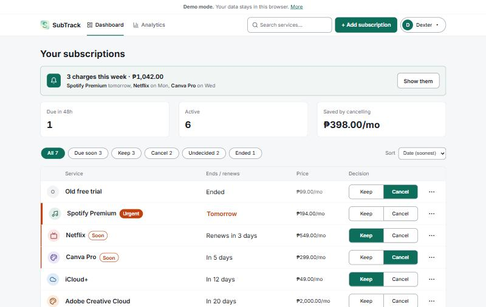
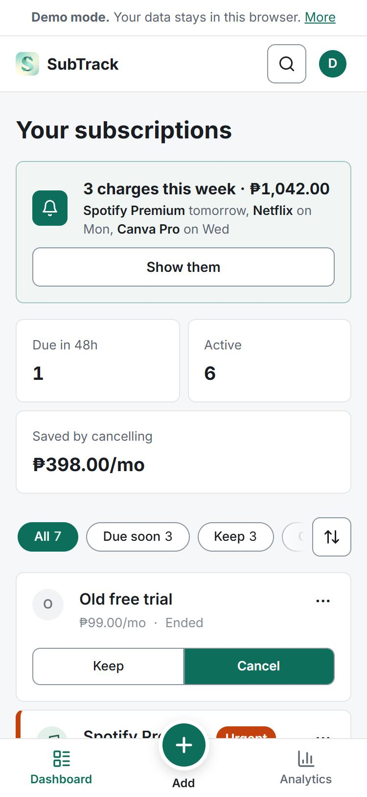
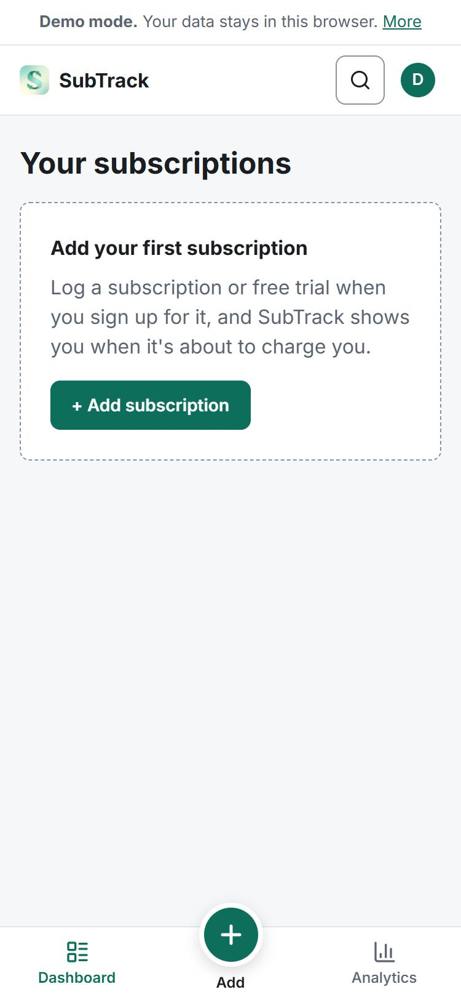
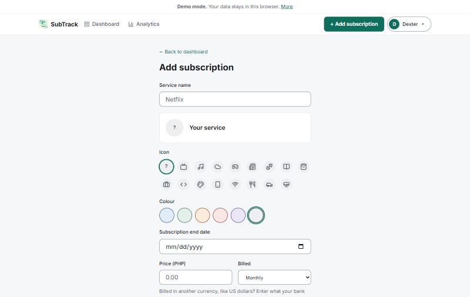
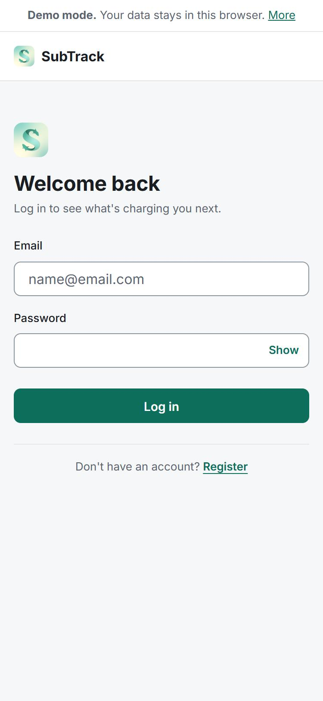
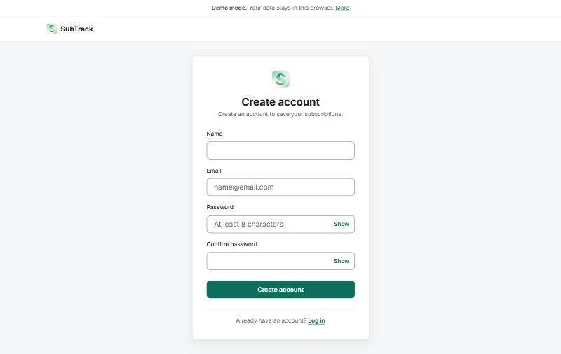
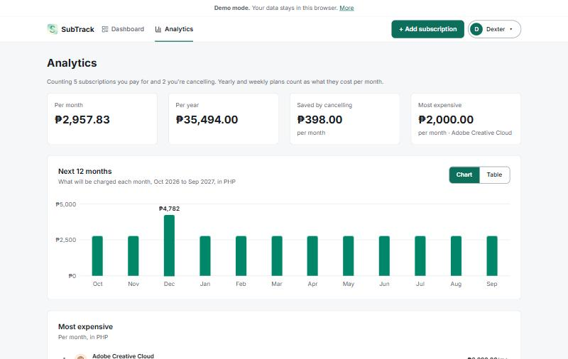
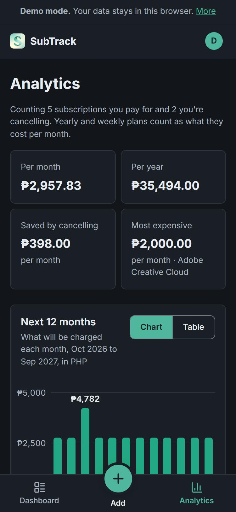

# Mockup

What SubTrack looks like, screen by screen. These are **screenshots of the
finished app**, taken on 9 October 2026 in demo mode with **invented sample
data** (no real accounts or people). They are shown next to my original
**wireframes**, which the app was built from.

- Wireframes (desktop and phone, every screen): [assets/wireframes.png](assets/wireframes.png)
- Design system (PDF): [assets/design-system.pdf](assets/design-system.pdf), see [03-design-system.md](03-design-system.md)

## Dashboard

The home screen: the "Due this week" banner, the summary cards, the filter
pills and sort, and the list sorted by date. "Urgent" (within 48 hours) and
"Soon" (within 7 days) use the accent colour and a stripe on the left.

On a phone, rows become cards and the main navigation is a bottom bar with a
round Add button:

**Empty state**, for a new account with no subscriptions yet:

## Add and Edit subscription

One form for both routes: `/add` starts blank, and `/edit/:id` loads the
subscription first and adds a Delete button.

## Log in and Register

## Analytics (added after the proposal)

What you pay per month and per year, savings, the most expensive subscription,
and a 12-month forecast with a table view.

Dark mode, on a phone:

## Honest note: wireframes compared with the app

- **Built as wireframed:** the Dashboard's header, summary cards, pills and
  list; Add/Edit as one form; Log in and Register in a centred card on desktop.
- **Not built:** the "You're viewing sample data" banner. Real accounts start
  empty, so the empty state above does that job. (Also in
  [01-proposal.md](01-proposal.md).)
- **Changed:** the phone header lost "+ Add". Phones use a bottom bar instead,
  because the bottom of the screen is easier to reach with a thumb. "Trial end
  date" became "Subscription end date".
- **Added:** the Analytics and Account pages, the "Due this week" banner, icons
  and colours per subscription, and dark mode.
- **Name and logo:** the wireframes say SubAlert with a plain square logo; the
  app is now SubTrack, with a logo drawn by my girlfriend.
